# Sitemap VokasIn — Lengkap

> Disusun berdasarkan dokumen `sitemap.md`. Nama rute, role, dependensi, dan alur mengikuti sumber; tidak menambahkan rute baru.

## 1. Ringkasan struktur

- **Publik / Tamu** — 6 rute
- **Guru Produktif (`guru_produktif`)** — 7 rute
- **Kaprogli (`kaprogli`)** — 3 rute
- **Administrator (`admin`)** — 5 rute
- **Total** — 21 rute halaman
- **API yang tercantum** — 1 endpoint: `POST /api/auth/login`

## 2. Sitemap hierarkis

```text
VokasIn
├── Zona Publik / Tamu
│   ├── /                                      Beranda / Landing Page
│   ├── /login                                 Autentikasi & Demo Quick-Login
│   ├── /jelajah-kompetensi                    Katalog Eksplorasi SKKNI
│   ├── /roadmap                               Direktori Roadmap Program Keahlian
│   │   └── /roadmap/[programKeahlianId]       Peta Alur Belajar & Kurikulum Jurusan
│   └── /kunjungan-industri                    Panduan & Jadwal Penyelarasan Industri
│
├── Zona Guru Produktif — role: guru_produktif
│   ├── /guru                                  Dashboard Guru & Matriks Pembelajaran
│   │   ├── /guru/susun/[unitId]                Workspace Penyusunan Modul (Single Unit)
│   │   ├── /guru/susun/multi                   Workspace Modul Gabungan (Multi-Unit)
│   │   ├── /guru/tinjau                        Tinjauan Komparatif Modul vs SKKNI
│   │   ├── /guru/bahan-ajar                    Repositori Perangkat Ajar
│   │   │   └── /guru/bahan-ajar/[mapelId]      Detail Perangkat Ajar Spesifik Mapel
│   │   └── /guru/unggah-skkni                  Pengajuan Draf SKKNI Baru
│
├── Zona Kaprogli — role: kaprogli
│   ├── /kaprogli                              Dashboard Audit Kurikulum & Skill Delta
│   ├── /kaprogli/lab                          Manajemen Inventaris Lab & Kesiapan Alat
│   └── /kaprogli/unggah-skkni                 Kurasi & Pengunggahan SKKNI Jurusan
│
└── Zona Administrator — role: admin
    ├── /admin                                 Dashboard Analitik & Beban Institusi
    ├── /admin/pengguna                        Tata Kelola Akun & Penugasan Guru
    ├── /admin/skkni                           Master Data Unit & Standar SKKNI
    │   └── /admin/skkni/kandidat              Verifikasi Sinyal Pasar & Kandidat Unit
    └── /admin/pengaturan                      Konfigurasi Sistem & Parameter Penilaian
```

## 3. Diagram arsitektur navigasi

```mermaid
flowchart TD
    subgraph Public["Zona Publik / Tamu"]
        HOME["/ — Beranda / Landing Page"]
        LOGIN["/login — Autentikasi & Demo Quick-Login"]
        JELAJAH["/jelajah-kompetensi — Katalog SKKNI"]
        ROADMAP["/roadmap — Direktori Program Keahlian"]
        ROADMAPDET["/roadmap/[programKeahlianId] — Peta Alur Belajar"]
        KUNJUNGAN["/kunjungan-industri — Penyelarasan Industri & Magang"]
    end

    subgraph Guru["Zona Guru Produktif — guru_produktif"]
        GDASH["/guru — Dashboard & Jadwal JP"]
        GSUSUN["/guru/susun/[unitId] — Susun Modul Single Unit"]
        GMULTI["/guru/susun/multi — Susun Modul Multi-Unit"]
        GTINJAU["/guru/tinjau — Tinjauan & Audit Modul"]
        GBAHAN["/guru/bahan-ajar — Arsip Perangkat Ajar"]
        GBAHANDET["/guru/bahan-ajar/[mapelId] — Detail Perangkat Ajar"]
        GUPLOAD["/guru/unggah-skkni — Usulan SKKNI"]
    end

    subgraph Kaprogli["Zona Kaprogli — kaprogli"]
        KDASH["/kaprogli — Audit Kurikulum & Skill Delta"]
        KLAB["/kaprogli/lab — Inventaris Lab"]
        KUPLOAD["/kaprogli/unggah-skkni — Kurasi SKKNI Jurusan"]
    end

    subgraph Admin["Zona Administrator — admin"]
        ADASH["/admin — Analitik & Beban Institusi"]
        AUSER["/admin/pengguna — Manajemen Pengguna"]
        ASKKNI["/admin/skkni — Master Data SKKNI"]
        AKANDIDAT["/admin/skkni/kandidat — Kurasi Kandidat Kompetensi"]
        ASETTING["/admin/pengaturan — Pengaturan Sistem"]
    end

    HOME --> JELAJAH
    HOME --> ROADMAP
    HOME --> KUNJUNGAN
    HOME --> LOGIN
    ROADMAP --> ROADMAPDET

    LOGIN -->|Role guru_produktif| GDASH
    LOGIN -->|Role kaprogli| KDASH
    LOGIN -->|Role admin| ADASH

    GDASH --> GSUSUN
    GDASH --> GMULTI
    GDASH --> GBAHAN
    GDASH --> GUPLOAD
    GSUSUN --> GTINJAU
    GMULTI --> GTINJAU
    GBAHAN --> GBAHANDET

    KDASH --> KLAB
    KDASH --> KUPLOAD
    KDASH -. "Referensi linieritas" .-> ROADMAPDET

    ADASH --> AUSER
    ADASH --> ASKKNI
    ASKKNI --> AKANDIDAT
    ADASH --> ASETTING
```



## 4. Daftar lengkap rute, akses, dan fungsi

| No. | Rute | Halaman / fungsi | Akses | Server Action / API / dependensi yang disebut |
|---:|---|---|---|---|
| 1 | `/` | Beranda, value proposition, statistik dampak, pratinjau fitur, CTA | Publik | Client navigation |
| 2 | `/login` | Form login dan Quick Demo Role Switching untuk Guru, Kaprogli, Admin | Publik | `loginAction`, `quickLoginAction`, `logoutAction`; `app/login/actions.ts`; `lib/auth.ts` |
| 3 | `/jelajah-kompetensi` | Pencarian SKKNI berdasarkan kode, bidang kejuruan, atau kata kunci elemen; filter kategori/jurusan | Publik | Filter client & DB read; `getUnitKompetensi`, `getProgramKeahlian` |
| 4 | `/roadmap` | Direktori program keahlian dan ringkasan kompetensi | Publik | Data Program Keahlian |
| 5 | `/roadmap/[programKeahlianId]` | Pohon kompetensi dan alur semester Fase E–F | Publik | Detail alur dan SKKNI per semester; parameter dinamis `programKeahlianId` |
| 6 | `/kunjungan-industri` | Mitra industri, MoU, rencana kunjungan, standar kompetensi, jadwal sinkronisasi | Publik | View statis & data kemitraan |
| 7 | `/guru` | Matriks beban mengajar, total JP, unit aktif, jadwal mingguan, draf modul | `guru_produktif` | `listJadwal`, `getJpSummaryByGuru`, `getUnitKompetensiByProgram`; `lib/data-access-db.ts`, `lib/data-access.ts` |
| 8 | `/guru/susun/[unitId]` | Workspace HITL untuk merumuskan tujuan belajar, praktikum, jobsheet, dan rubrik | `guru_produktif` | `getUnitKompetensiById`; validasi `getLabForProgram`; ekspor Markdown/print |
| 9 | `/guru/susun/multi` | Menggabungkan beberapa unit SKKNI menjadi satu modul praktikum terpadu | `guru_produktif` | Batch Synthesis Engine; unit picker dan generator jobsheet PBL |
| 10 | `/guru/tinjau` | Audit modul sebelum finalisasi; validasi saran AI dan referensi KUK | `guru_produktif` | Evaluasi keselarasan kurikulum; checklist dan penerbitan modul |
| 11 | `/guru/bahan-ajar` | Repositori perangkat ajar mandiri/kolaboratif | `guru_produktif` | Daftar modul terbitan guru |
| 12 | `/guru/bahan-ajar/[mapelId]` | Detail perangkat ajar, tampilan siap cetak, unduh PDF/Markdown | `guru_produktif` | Unduh dan cetak modul/jobsheet |
| 13 | `/guru/unggah-skkni` | Mengunggah atau mengusulkan SKKNI yang belum ada di katalog | `guru_produktif` | Parser draf SKKNI; file PDF/JSON; verifikasi Kaprogli/Admin |
| 14 | `/kaprogli` | Audit kurikulum, Skill Delta Score, gap kompetensi, kesiapan guru | `kaprogli` | `toggleGapReviewedAction`; `getSkillDeltaReport`, `getGapKandidat`, `listAllGuru`, `listMataPelajaran` |
| 15 | `/kaprogli/lab` | Inventaris alat/mesin/bahan praktikum, kondisi dan jumlah tersedia | `kaprogli` | `updateLabToolAction`, CRUD alat lab; `app/kaprogli/lab/actions.ts` |
| 16 | `/kaprogli/unggah-skkni` | Pengunggahan dan kurasi SKKNI tingkat program keahlian | `kaprogli` | Pengajuan integrasi kurikulum baru ke administrator |
| 17 | `/admin` | Analitik institusi, guru aktif, distribusi JP, kesiapan lab, sinkronisasi SKKNI | `admin` | `getAdminAnalyticsData`; `lib/data-access-db.ts` |
| 18 | `/admin/pengguna` | Manajemen akun guru/Kaprogli, penugasan mapel, alokasi JP, perizinan | `admin` | CRUD Guru, Assign JP; `app/admin/pengguna/actions.ts` |
| 19 | `/admin/skkni` | Master unit SKKNI, status aktif/arsip, sinkronisasi berkas | `admin` | `syncSkkniAction`, `updateSkkniStatus`; `app/admin/skkni/actions.ts` |
| 20 | `/admin/skkni/kandidat` | Review kandidat kompetensi dari usulan/tren industri; approve/reject | `admin` | `approveKandidatAction`, `rejectKandidatAction`; `app/admin/skkni/kandidat/actions.ts` |
| 21 | `/admin/pengaturan` | Nama sekolah, semester/tahun ajaran, ambang Skill Delta, kunci API AI, parameter generator | `admin` | Konfigurasi bobot & integrasi LLM |

## 5. Alur navigasi utama

1. **Pengunjung:** `/` → `/jelajah-kompetensi`, `/roadmap`, `/kunjungan-industri`, atau `/login`.
2. **Eksplorasi jurusan:** `/roadmap` → `/roadmap/[programKeahlianId]`.
3. **Guru:** `/login` → `/guru` → penyusunan single/multi-unit, arsip perangkat ajar, atau pengajuan SKKNI. Workspace penyusunan dapat dilanjutkan ke `/guru/tinjau`; arsip menuju detail mata pelajaran.
4. **Kaprogli:** `/login` → `/kaprogli` → inventaris lab atau kurasi SKKNI. Dashboard juga memiliki referensi linieritas menuju detail roadmap.
5. **Administrator:** `/login` → `/admin` → manajemen pengguna, master SKKNI, atau pengaturan. Master SKKNI menuju halaman kandidat kompetensi.

## 6. API endpoint yang tercantum

| Endpoint | Method | Fungsi | Autentikasi |
|---|---|---|---|
| `/api/auth/login` | `POST` | Autentikasi API, validasi role, penerbitan cookie sesi | Publik |

> Dokumen sumber hanya mencantumkan endpoint API di atas pada bagian API Endpoints. Action dan dependensi yang muncul pada spesifikasi tiap halaman tetap dicantumkan sebagai dependensi, bukan diasumsikan sebagai endpoint tambahan.

## 7. Proteksi rute dan role access

Proteksi utama disebut berada pada `middleware.ts` yang meneruskan evaluasi ke `proxy.ts`, menggunakan `SESSION_COOKIE_NAME`.

- `/guru/*` memerlukan token sesi dengan `role === "guru_produktif"`.
- `/kaprogli/*` memerlukan token sesi dengan `role === "kaprogli"`.
- `/admin/*` memerlukan token sesi dengan `role === "admin"`.
- Jika sesi tidak ditemukan atau role tidak sesuai, pengguna dialihkan ke `/login`.

## 8. Catatan konsistensi berdasarkan sumber

- Dokumen menyebut 4 zona akses: Publik, Guru Produktif, Kaprogli, dan Administrator.
- Total rute halaman dalam matriks adalah 21.
- Parameter rute dinamis dipertahankan sesuai sumber: `[programKeahlianId]`, `[unitId]`, dan `[mapelId]`.
- Relasi antarrute pada diagram menggambarkan alur yang secara eksplisit disebut dalam dokumen; diagram tidak menyatakan bahwa rute yang tidak terhubung tidak dapat diakses dengan cara lain.
