# Sitemap & Arsitektur Navigasi — VokasIn

Dokumen ini menyajikan peta situs (*sitemap*), arsitektur informasi, matriks hak akses (*role-based access control*), alur navigasi pengguna (*user journey*), serta spesifikasi teknis mendalam untuk seluruh rute halaman di dalam platform **VokasIn**.

---

## 1. Ikhtisar & Matriks Aksesibilitas Halaman

Sistem VokasIn membagi akses rute menjadi 4 zona utama yang dikontrol melalui `middleware.ts` / `proxy.ts`:
- **Publik / Tamu**: Dapat diakses tanpa autentikasi (Landing, Eksplorasi SKKNI, Roadmap, Login).
- **Guru Produktif (`/guru/*`)**: Khusus pendidik kejuruan untuk merancang modul ajar, jobsheet, rubrik, dan jadwal mengajar.
- **Kaprogli (`/kaprogli/*`)**: Ketua Program Keahlian untuk audit kurikulum, analisis gap (*Skill Delta*), manajemen lab, dan usulan kompetensi.
- **Administrator (`/admin/*`)**: Pengelola sistem sekolah untuk manajemen akun, beban mengajar institusi, dan tata kelola SKKNI.

| No | Path Rute | Nama / Modul Halaman | Role Akses | Status Fitur | Server Action / API Terkait |
|:---|:---|:---|:---|:---|:---|
| 1 | `/` | Beranda / Landing Page & Value Proposition | Publik | Aktif (Produksi) | Client navigation |
| 2 | `/login` | Autentikasi Pengguna & Demo Quick-Login | Publik | Aktif (Produksi) | `loginAction`, `quickLoginAction` |
| 3 | `/jelajah-kompetensi` | Katalog Eksplorasi SKKNI Interaktif | Publik | Aktif (Produksi) | Filter client & DB read |
| 4 | `/roadmap` | Direktori Roadmap Program Keahlian | Publik | Aktif (Produksi) | Data Program Keahlian |
| 5 | `/roadmap/[programKeahlianId]` | Peta Alur Belajar & Kurikulum Jurusan | Publik | Aktif (Produksi) | Detail Alur & SKKNI per semester |
| 6 | `/kunjungan-industri` | Panduan & Jadwal Penyelarasan Industri | Publik | Aktif (Produksi) | View statis & data kemitraan |
| 7 | `/guru` | Dashboard Utama Guru & Matriks Pembelajaran | `guru_produktif` | Aktif (Produksi) | `listJadwal`, `getJpSummaryByGuru` |
| 8 | `/guru/susun/[unitId]` | Workspace HITL Modul Ajar (Single Unit) | `guru_produktif` | Aktif (Produksi) | Modul Generator, Export Markdown/Print |
| 9 | `/guru/susun/multi` | Workspace Multi-Unit Kompetensi | `guru_produktif` | Aktif (Produksi) | Batch Synthesis Engine |
| 10 | `/guru/tinjau` | Tinjauan Komparatif Modul vs SKKNI | `guru_produktif` | Aktif (Produksi) | Evaluasi keselarasan kurikulum |
| 11 | `/guru/bahan-ajar` | Repositori Dokumen Perangkat Ajar | `guru_produktif` | Aktif (Produksi) | List modul terbitan guru |
| 12 | `/guru/bahan-ajar/[mapelId]` | Detail Perangkat Ajar Spesifik Mapel | `guru_produktif` | Aktif (Produksi) | Unduh & cetak modul/jobsheet |
| 13 | `/guru/unggah-skkni` | Pengajuan Berkas SKKNI Baru oleh Guru | `guru_produktif` | Aktif (Produksi) | Parsir draf SKKNI |
| 14 | `/kaprogli` | Dashboard Audit Kurikulum & Skill Delta | `kaprogli` | Aktif (Produksi) | `toggleGapReviewedAction` |
| 15 | `/kaprogli/lab` | Manajemen Inventaris Lab & Kesiapan Alat | `kaprogli` | Aktif (Produksi) | `updateLabToolAction`, CRUD Alat Lab |
| 16 | `/kaprogli/unggah-skkni` | Kurasi & Pengunggahan SKKNI Jurusan | `kaprogli` | Aktif (Produksi) | Pengajuan integrasi kurikulum baru |
| 17 | `/admin` | Dashboard Analitik & Beban Institusi | `admin` | Aktif (Produksi) | `getAdminAnalyticsData` |
| 18 | `/admin/pengguna` | Tata Kelola Akun & Penugasan Guru | `admin` | Aktif (Produksi) | CRUD Guru, Assign Jam Pelajaran (JP) |
| 19 | `/admin/skkni` | Master Data Unit & Standar SKKNI | `admin` | Aktif (Produksi) | `syncSkkniAction`, `updateSkkniStatus` |
| 20 | `/admin/skkni/kandidat` | Verifikasi Sinyal Pasar & Kandidat Unit | `admin` | Aktif (Produksi) | `approveKandidatAction`, `rejectAction` |
| 21 | `/admin/pengaturan` | Konfigurasi Sistem & Parameter Penilaian | `admin` | Aktif (Produksi) | Konfigurasi bobot & integrasi LLM |

---

## 2. Diagram Visual Arsitektur Navigasi

```mermaid
flowchart TD
    subgraph Public["🌐 Zona Publik"]
        R_HOME["/ (Landing Page)"]
        R_LOGIN["/login (Login Portal)"]
        R_JELAJAH["/jelajah-kompetensi (Katalog SKKNI)"]
        R_ROADMAP["/roadmap (Pilihan Jurusan)"]
        R_ROADMAP_DET["/roadmap/:programKeahlianId"]
        R_KUNJUNGAN["/kunjungan-industri"]
    end

    subgraph Guru["👨‍🏫 Zona Guru Produktif (/guru)"]
        G_DASH["/guru (Dashboard & Jadwal JP)"]
        G_SUSUN["/guru/susun/:unitId (HITL Workspace)"]
        G_MULTI["/guru/susun/multi (Multi-Unit Synth)"]
        G_TINJAU["/guru/tinjau (Review & Audit)"]
        G_BAHAN["/guru/bahan-ajar (Arsip Modul)"]
        G_BAHAN_DET["/guru/bahan-ajar/:mapelId"]
        G_UPLOAD["/guru/unggah-skkni (Usulan Dokumen)"]
    end

    subgraph Kaprogli["📊 Zona Kaprogli (/kaprogli)"]
        K_DASH["/kaprogli (Dashboard Skill Delta)"]
        K_LAB["/kaprogli/lab (Inventaris Lab & Kesiapan)"]
        K_UPLOAD["/kaprogli/unggah-skkni (Kurasi Jurusan)"]
    end

    subgraph Admin["⚙️ Zona Admin (/admin)"]
        A_DASH["/admin (Audit Beban & Analitik)"]
        A_USER["/admin/pengguna (Manajemen Akun Guru)"]
        A_SKKNI["/admin/skkni (Master Data SKKNI)"]
        A_KANDIDAT["/admin/skkni/kandidat (Kurasi Unit Baru)"]
        A_SETTING["/admin/pengaturan (Konfigurasi Global)"]
    end

    %% Routing Flow
    R_HOME --> R_JELAJAH
    R_HOME --> R_ROADMAP
    R_HOME --> R_KUNJUNGAN
    R_HOME --> R_LOGIN
    R_ROADMAP --> R_ROADMAP_DET

    R_LOGIN -->|Role: guru_produktif| G_DASH
    R_LOGIN -->|Role: kaprogli| K_DASH
    R_LOGIN -->|Role: admin| A_DASH

    %% Guru Flow
    G_DASH --> G_SUSUN
    G_DASH --> G_MULTI
    G_DASH --> G_BAHAN
    G_DASH --> G_UPLOAD
    G_SUSUN --> G_TINJAU
    G_MULTI --> G_TINJAU
    G_BAHAN --> G_BAHAN_DET

    %% Kaprogli Flow
    K_DASH --> K_LAB
    K_DASH --> K_UPLOAD
    K_DASH -. Ref Linieritas .-> R_ROADMAP_DET

    %% Admin Flow
    A_DASH --> A_USER
    A_DASH --> A_SKKNI
    A_SKKNI --> A_KANDIDAT
    A_DASH --> A_SETTING
```

---

## 3. Spesifikasi Rinci Seluruh Rute

### 3.1. Rute Publik (Unauthenticated)

#### 1. `/` — Landing Page & Beranda
- **Deskripsi:** Halaman penyambutan utama yang menjelaskan diferensiasi VokasIn sebagai asisten HITL (*Human-in-the-Loop*) untuk guru SMK dan kaprogli. Menampilkan statistik dampak, pratinjau fitur, dan call-to-action ke login.
- **Komponen Utama:** Hero banner interaktif, ringkasan manfaat, simulasi kartu SKKNI, CTA Button.
- **Data Input / Output:** Tidak ada input pengguna. Output: Konten edukasi dan rute navigasi.
- **Alur Transisi:** Navigasi ke `/login`, `/jelajah-kompetensi`, `/roadmap`, atau `/kunjungan-industri`.

#### 2. `/login` — Portal Autentikasi Pengguna
- **Deskripsi:** Halaman login dengan formulir kredensial dan tombol *Quick Demo Role Switching* untuk pengujian kilat (Guru, Kaprogli, Admin).
- **Komponen Utama:** `LoginForm`, pilihan switch akun cepat, pesan peringatan kesalahan sesi.
- **Dependensi Server Action / API:** `app/login/actions.ts` (`loginAction`, `quickLoginAction`, `logoutAction`), `lib/auth.ts`.
- **Alur Transisi:** Redirect otomatis via session cookie ke `/guru`, `/kaprogli`, atau `/admin`.

#### 3. `/jelajah-kompetensi` — Eksplorasi SKKNI Interaktif
- **Deskripsi:** Katalog publik dokumen Standar Kompetensi Kerja Nasional Indonesia yang telah distrukturkan ke format digital. Pengguna dapat mencari unit kompetensi berdasarkan kode, bidang kejuruan, atau kata kunci elemen.
- **Komponen Utama:** Input pencarian multi-parameter, chip filter kategori industri/jurusan, tabel/kartu elemen kompetensi dan kriteria unjuk kerja (KUK).
- **Dependensi Data:** `lib/data-access.ts` (`getUnitKompetensi`, `getProgramKeahlian`).

#### 4. `/roadmap` — Direktori Program Keahlian
- **Deskripsi:** Indeks program keahlian SMK (seperti TKJ, RPL, DKV, Mekatronika) yang tersedia pada institusi vokasi terkait.
- **Komponen Utama:** Kartu kejuruan interaktif dengan ringkasan jumlah kompetensi dan konsentrasi keahlian.
- **Alur Transisi:** Klik kartu jurusan membuka `/roadmap/[programKeahlianId]`.

#### 5. `/roadmap/[programKeahlianId]` — Peta Alur Belajar & Kurikulum Jurusan
- **Deskripsi:** Visualisasi pohon kompetensi dan alur semester bagi jurusan tertentu. Memetakan unit SKKNI mana yang diajarkan pada Fase E (Kelas X) hingga Fase F (Kelas XI - XII).
- **Komponen Utama:** Timeline semester, pemetaan linieritas SKKNI vs KUK industri, indikator kesiapan materi.
- **Data Dinamis:** Parameter `programKeahlianId` (misal: `pk-tkj`, `pk-rpl`).

#### 6. `/kunjungan-industri` — Penyelarasan Industri & Magang
- **Deskripsi:** Informasi integrasi kurikulum dengan mitra industri nyata (MoU, rencana kunjungan industri, sertifikasi mitra seperti TBIG, Axioo, Mikrotik).
- **Komponen Utama:** Daftar industri rekanan, standar kompetensi industri yang disyaratkan, jadwal sinkronisasi.

---

### 3.2. Zona Guru Produktif (`/guru/*`)

#### 7. `/guru` — Dashboard Guru & Pengaturan Beban Mengajar
- **Deskripsi:** Beranda kerja guru produktif. Menampilkan matriks beban mengajar real-time (total JP diampu), daftar unit SKKNI aktif, jadwal mingguan, serta draf modul ajar yang belum selesai.
- **Komponen Utama:** `GuruTabsContainer`, `GuruUnitListPaginated`, `AsistenKebutuhanModul`, `DraftStatusBar`, kalkulator JP.
- **Dependensi Data:** `lib/data-access-db.ts` (`listJadwal`, `getJpSummaryByGuru`), `lib/data-access.ts` (`getUnitKompetensiByProgram`).
- **Alur Transisi:** Membuka workspace penyusunan (`/guru/susun/[unitId]` atau `/guru/susun/multi`), arsip modul (`/guru/bahan-ajar`), atau pengajuan SKKNI.

#### 8. `/guru/susun/[unitId]` — Workspace Penyusunan Modul Ajar (Single Unit)
- **Deskripsi:** Ruang kerja utama Human-in-the-Loop. Guru memilih elemen SKKNI, memvalidasi ketersediaan alat lab, dan memicu AI untuk merumuskan tujuan pembelajaran, skenario praktikum, jobsheet step-by-step, dan rubrik penilaian.
- **Komponen Utama:** Editor interaktif modul, detektor kesiapan alat lab (peringatan alat hilang), selector skenario ajar, tombol validasi/accept AI.
- **Dependensi Data:** `getUnitKompetensiById`, validasi terhadap `getLabForProgram`.
- **Alur Transisi:** Simpan draf, cetak/ekspor, atau lanjut ke `/guru/tinjau`.

#### 9. `/guru/susun/multi` — Workspace Modul Gabungan (Multi-Unit)
- **Deskripsi:** Alat canggih untuk mengombinasikan beberapa unit SKKNI sekaligus menjadi 1 modul ajar praktikum terpadu (proyek lintas kompetensi).
- **Komponen Utama:** Unit picker multi-select, penyeimbang jam pelajaran, generator jobsheet berbasis proyek (PBL).
- **Alur Transisi:** Tinjau hasil sintesis di `/guru/tinjau`.

#### 10. `/guru/tinjau` — Tinjauan & Audit Modul Ajar
- **Deskripsi:** Layar audit sebelum modul difinalisasi. Memastikan 100% saran AI telah dikonfirmasi eksplisit oleh guru dan seluruh rujukan KUK tercantum dengan jelas.
- **Komponen Utama:** Checklist kepatuhan standar, perbandingan side-by-side SKKNI vs Konten Ajar, tombol terbitkan modul.

#### 11. `/guru/bahan-ajar` — Direktori Perangkat Ajar
- **Deskripsi:** Repositori arsip perangkat ajar mandiri dan kolaboratif yang siap diajarkan di kelas.
- **Komponen Utama:** Filter per mata pelajaran/fase, status kelengkapan (Jobsheet, Rubrik, Lembar Kerja).
- **Alur Transisi:** Klik mata pelajaran untuk masuk ke `/guru/bahan-ajar/[mapelId]`.

#### 12. `/guru/bahan-ajar/[mapelId]` — Detail Perangkat Ajar Spesifik
- **Deskripsi:** Lembar kerja spesifik per mata pelajaran. Menyediakan pratinjau cetak (*print-ready view*) dan tombol unduh dokumen PDF/Markdown.
- **Komponen Utama:** Tampilan dokumen formal standar Kurikulum Merdeka, panduan instruktur praktikum.

#### 13. `/guru/unggah-skkni` — Pengajuan Draf SKKNI Baru
- **Deskripsi:** Formulir bagi guru untuk mengunggah atau mengusulkan dokumen SKKNI baru yang belum ada di katalog sistem.
- **Komponen Utama:** File uploader (PDF/JSON), parser ekstraktor unit dasar, status verifikasi oleh Kaprogli/Admin.

---

### 3.3. Zona Ketua Program Keahlian (`/kaprogli/*`)

#### 14. `/kaprogli` — Dashboard Audit Kurikulum & Skill Delta
- **Deskripsi:** Ruang kontrol Kaprogli untuk mengevaluasi keselarasan kurikulum jurusan dengan standar industri. Menampilkan metrik *Skill Delta Score*, daftar kompetensi berisiko (gap tinggi), dan ringkasan kesiapan guru.
- **Komponen Utama:** Kartu metrik circular progress (Skill Delta Index), daftar gap kandidat unit, tombol tinjau usulan (`toggleGapReviewedAction`).
- **Dependensi Data:** `lib/data-access.ts` (`getSkillDeltaReport`, `getGapKandidat`), `lib/data-access-db.ts` (`listAllGuru`, `listMataPelajaran`).

#### 15. `/kaprogli/lab` — Manajemen Inventaris Lab & Kesiapan Praktikum
- **Deskripsi:** Manajemen alat, mesin, dan bahan praktikum di laboratorium jurusan. Data ini menjadi acuan sistem saat guru menyusun modul ajar agar praktikum yang dirancang realistis.
- **Komponen Utama:** Tabel inventaris alat, status kondisi (Baik, Rusak, Butuh Kalibrasi), jumlah unit tersedia, modal tambah/edit alat.
- **Dependensi Server Action:** `app/kaprogli/lab/actions.ts` (`updateLabToolAction`, CRUD tools).

#### 16. `/kaprogli/unggah-skkni` — Kurasi & Pengunggahan SKKNI Jurusan
- **Deskripsi:** Portal pengunggahan SKKNI tingkat program keahlian dengan validasi kelengkapan elemen sebelum diajukan ke administrator institusi.
- **Komponen Utama:** Dropzone dokumen, pemetaan jurusan target, status penelaahan admin.

---

### 3.4. Zona Administrator Sekolah (`/admin/*`)

#### 17. `/admin` — Dashboard Administrasi & Beban Sekolah
- **Deskripsi:** Ringkasan analitik institusional menyeluruh: total guru aktif, distribusi jam pelajaran (JP), rasio kesiapan lab seluruh jurusan, dan status sinkronisasi SKKNI.
- **Komponen Utama:** `AdminTopbar`, `AdminAnalytics` (grafik beban mengajar, metrik kurikulum).
- **Dependensi Data:** `lib/data-access-db.ts` (`getAdminAnalyticsData`).

#### 18. `/admin/pengguna` — Tata Kelola Pengguna & Penugasan Mengajar
- **Deskripsi:** Manajemen akun guru dan kaprogli. Administrator dapat mengatur penugasan mata pelajaran, alokasi jam mengajar per minggu, serta perizinan akun.
- **Komponen Utama:** Tabel pengguna dengan fitur pencarian/filter, modal edit peran, konfigurasi alokasi JP.
- **Dependensi Server Action:** `app/admin/pengguna/actions.ts`.

#### 19. `/admin/skkni` — Master Data SKKNI Nasional
- **Deskripsi:** Pusat pengelolaan seluruh database SKKNI yang aktif di sekolah. Mengatur apakah suatu unit berlaku, diarsipkan, atau disesuaikan dengan edisi terbaru Kemnaker/BNSP.
- **Komponen Utama:** Tabel master unit kompetensi, pencarian nomor registrasi SKKNI, tombol sinkronisasi berkas.
- **Dependensi Server Action:** `app/admin/skkni/actions.ts`.

#### 20. `/admin/skkni/kandidat` — Kurasi Kandidat Kompetensi Sinyal Industri
- **Deskripsi:** Layar peninjauan kompetensi baru yang diusulkan oleh guru/kaprogli atau dideteksi dari tren industri yang belum masuk SKKNI formal. Admin dapat menyetujui (*approve*) atau menolak (*reject*) integrasi ke sistem.
- **Komponen Utama:** Kartu review kandidat, metrik kebutuhan industri, komparator kompetensi.
- **Dependensi Server Action:** `app/admin/skkni/kandidat/actions.ts` (`approveKandidatAction`, `rejectKandidatAction`).

#### 21. `/admin/pengaturan` — Konfigurasi Parameter Institusi
- **Deskripsi:** Konfigurasi global sekolah (Nama Sekolah, Semester/Tahun Ajaran Aktif, Nilai Ambang Batas Skill Delta, Integrasi Kunci API AI).
- **Komponen Utama:** Form pengaturan sistem, switcher tahun ajaran, manajemen parameter generator modul.

---

## 4. API Endpoints

| Endpoint | Method | Fungsi & Deskripsi | Autentikasi |
|:---|:---|:---|:---|
| `/api/auth/login` | `POST` | Autentikasi via API, validasi role, dan penerbitan sesi cookie | Publik |

---

## 5. Ringkasan Guard & Middleware Proteksi Rute

- Middleware utama didefinisikan pada `middleware.ts` yang meneruskan evaluasi ke `proxy.ts`.
- Pemeriksaan cookie `SESSION_COOKIE_NAME`:
  - Rute berawalan `/guru` **wajib** memiliki token sesi dengan `role === "guru_produktif"`.
  - Rute berawalan `/kaprogli` **wajib** memiliki token sesi dengan `role === "kaprogli"`.
  - Rute berawalan `/admin` **wajib** memiliki token sesi dengan `role === "admin"`.
  - Apabila sesi tidak ditemukan atau role tidak cocok, pengguna secara otomatis dialihkan ke `/login`.
